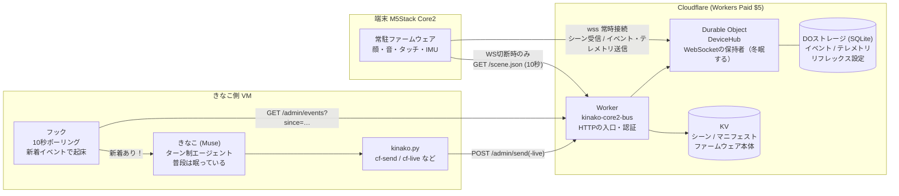
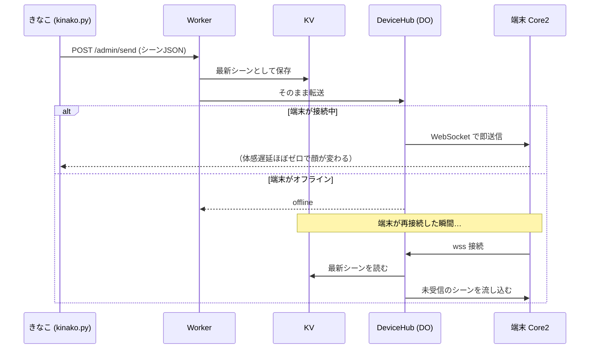
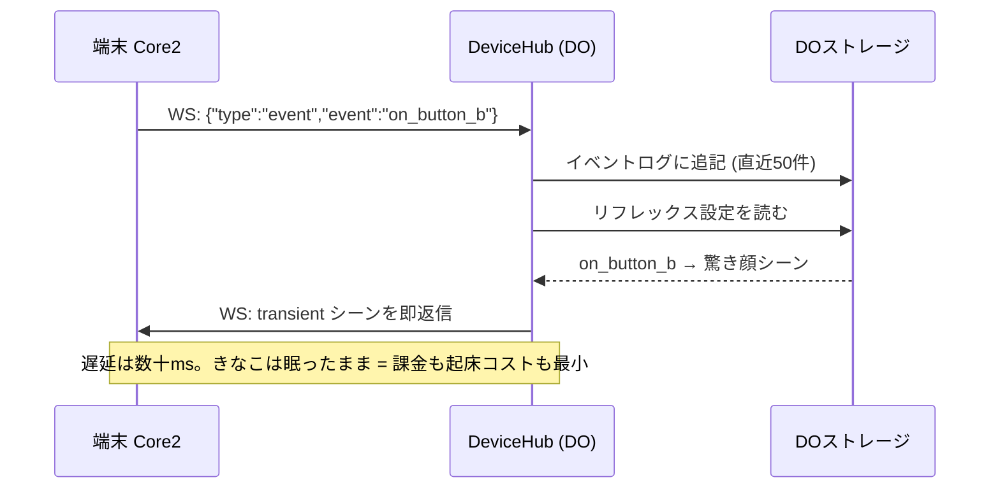
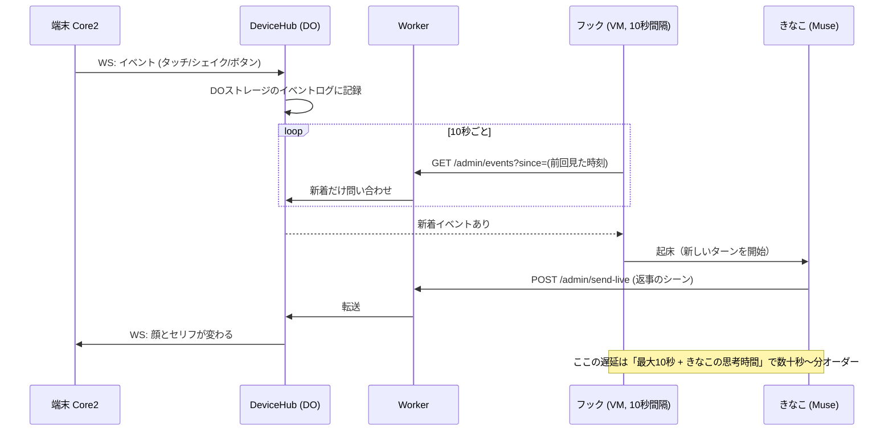
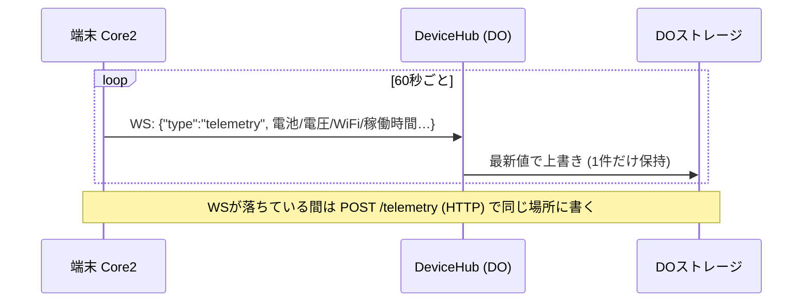
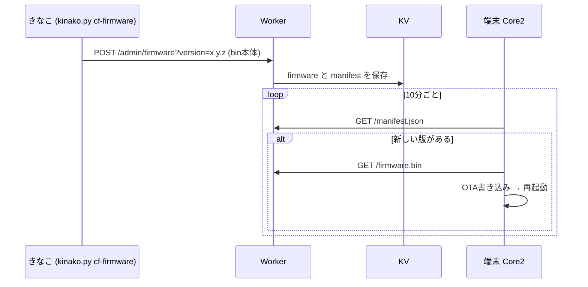

# きなっこちゃんの動作の仕組みと課金設計

このドキュメントは、きなっこちゃん（KinakoCore2）が「どう動いているか」と
「なぜ Cloudflare の $5 プランの枠内に収まるのか」を、図と数字で説明する。
設計の経緯は [ARCHITECTURE.md](ARCHITECTURE.md)、使い方は [SETUP.md](../SETUP.md)。

---

## 1. 全体像

登場人物は4つ。**端末（M5Stack Core2）**、**Cloudflare Worker + Durable Object（バス）**、
**きなこ（Muse、VM上で動くエージェント）**、そして**フック（VM上の小さな監視スクリプト）**。

ポイントは3つ。

- **つなぎっぱなしは Cloudflare 側だけ。** WebSocket を保持するのは Durable Object で、
  きなこ自身は常駐プロセスではない（→ 5章）。
- **配送は2経路。** ライブ（WebSocket で即届く）とストア（KV に最新シーンを置き、
  再接続時に流し込む）。片方が落ちてももう片方が拾う。
- **状態の置き場所を頻度で分けた。** よく変わるものは DO ストレージ、
  めったに変わらない・大きいものは KV（→ 4章）。

---

## 2. シーケンス図

### 2-1. きなこがシーンを送る（ライブ＋ストアの二重化）

一回性の反応（驚いた顔など、常駐シーンを上書きしたくないもの）は
`POST /admin/send-live` を使う。KV に保存せず、接続中の端末へだけ流す（transient）。

### 2-2. 端末イベント → リフレックス（きなこを起こさない反射）

### 2-3. 端末イベント → きなこが起きて返事をする

### 2-4. テレメトリ（端末の様子見）

### 2-5. ファームウェア更新 (OTA)

---

## 3. 状態の置き場所まとめ

| データ | 置き場所 | 書き込み頻度 | 理由 |
|---|---|---|---|
| 最新シーン | KV | きなこが送る時だけ | 再接続時に Worker/DO のどちらからでも読める |
| マニフェスト / ファーム本体 (約1.6MB) | KV | リリース時だけ | DO ストレージの値サイズ上限を超える。KV は 25MB まで可 |
| イベントログ (直近50件) | DO ストレージ | 端末イベントごと | 強整合・低遅延。フックが読む |
| 最新テレメトリ | DO ストレージ | 60秒ごと上書き | 頻繁な上書きは KV の苦手分野（後述） |
| リフレックス設定 | DO ストレージ | 設定変更時だけ | イベント処理の場でローカルに読める |

---

## 4. 課金の仕組みと最適化

前提: **Cloudflare Workers Paid（月 $5 の最低料金）** に入っている。
$5 は「使い放題」ではなく、各サービスに**含まれる枠**があり、超えた分だけ従量課金。
このシステムは全メーターを含まれる枠の中に収めるよう設計してある。

### 4-1. Workers Paid に含まれる枠（公式価格、2026-11確認）

| メーター | 含まれる枠 / 月 | 超過単価 |
|---|---|---|
| Worker リクエスト | 1,000万回 | $0.30 / 100万回 |
| Worker CPU 時間 | 3,000万 ms | $0.02 / 100万 ms |
| DO リクエスト | 100万回 | $0.15 / 100万回 |
| DO duration | 400,000 GB-s | $12.50 / 100万 GB-s（※超過分は100万単位に切り上げ） |
| DO ストレージ (SQLite) 行読み | 250億行 | $0.001 / 100万行 |
| DO ストレージ (SQLite) 行書き | 5,000万行 | $1.00 / 100万行 |
| KV 読み | 1,000万回 | $0.50 / 100万回 |
| KV 書き込み | 100万回 | $5.00 / 100万回 |

出典: Cloudflare 公式 [Workers 価格](https://developers.cloudflare.com/workers/platform/pricing/) /
[Durable Objects 価格](https://developers.cloudflare.com/durable-objects/platform/pricing/)

### 4-2. 最大の罠: DO の duration と WebSocket

DO の duration は「メモリに載っている時間 × 128MB」で課金される。
公式ドキュメントの脚注にも明記されている通り、**旧来の `server.accept()` で
WebSocket を受けると、接続している間ずっと duration が課金される**。

- 旧方式（accept）: 0.125 GB × 2,592,000 秒（30日）= **月 324,000 GB-s**
  → 含まれる 400,000 GB-s の **81% を1台の端末だけで占有**。
  他の DO を足したり超過したりすると、切り上げルールのせいで一気に +$12.50 跳ねる。
- 新方式（Hibernation API = `state.acceptWebSocket()`）: DO はアイドル時に冬眠でき、
  **冬眠可能なアイドル時間は課金されない**。課金はメッセージ処理など
  実際に JavaScript が走る時間だけ。このシステムでは月 数百 GB-s のオーダー（枠の 0.1% 未満）。

あわせて、端末のハートビート（15秒間隔の ping）は WebSocket のプロトコル ping なので
**課金対象外**（公式脚注）。受信メッセージは 20:1 に圧縮して数えられる
（100通 = 5リクエスト換算）ので、60秒ごとのテレメトリ 43,200通/月でも
DO リクエスト換算は 2,160回にしかならない。

### 4-3. KV を「よく変わる状態」に使わない理由

1. **単価**: 書き込みの超過単価が $5/100万回 と、DO ストレージの行書き
   （$1/100万行・枠も50倍）より割高。
2. **制限**: KV は**同一キーへの書き込みが1回/秒まで**。ボタン連打のような
   バーストで書き込みが弾かれる。
3. **遅さ**: KV は結果整合で、書き込みの伝播に最大60秒かかる。
   イベントを KV 経由でフックに渡すと、起床がその分遅れることがある。
   DO ストレージは強整合で、書いた直後に読める。

逆に、ファームウェア本体（約1.6MB）は DO ストレージの値サイズ上限を超えるため KV が正解。
「頻度と大きさ」で置き場所を分けるのが要点。

### 4-4. このシステムの月間使用量の試算（30日）

| メーター | 使用量の内訳 | 月間 | 枠に対する割合 |
|---|---|---|---|
| Worker リクエスト | フックのポーリング 10秒間隔 = 259,200回 + 管理操作・端末の予備ポーリング（僅か） | 約26万回 | 2.6% |
| DO リクエスト | フックポーリング 259,200回 + テレメトリ等のWSメッセージ換算 約2,200回 + 送信・状態確認（僅か） | 約26万回 | 26% |
| DO duration | 冬眠API。処理時間のみ（1回10msと仮定しても） | 約300 GB-s | 0.1% 未満 |
| DO ストレージ行書き | テレメトリ上書き 43,200行 + イベント（僅か） | 約4.3万行 | 0.1% 未満 |
| DO ストレージ行読み | ポーリング応答・リフレックス参照 | 約26万行 | 0.001% |
| KV 読み/書き | シーン取得・更新のみ | 数百〜数千回 | 誤差 |

**結論: 全部含まれる枠の中。請求は $5 きっかり**（同じアカウントで他の
Worker/DO を使っていない前提）。一番消費するのはフックのポーリングによる
DO リクエスト（枠の26%）で、それでも余裕がある。

### 4-5. フックのポーリングを 10 秒のままにする理由

間隔を延ばせば DO リクエストは減るが、枠に余裕がある以上、
削るべきはコストではなく**起床の遅さ**の方。10秒でも 26% しか使わないので、
速さを優先して据え置く。逆に 1 秒間隔にすると月 259万回で枠を超過するので、
「速くしたいなら 5 秒まで」が目安（約52万回 = 枠の52%）。

### 4-6. 補足: 12/1からの Observability（ログ）料金変更について

2026年12月1日から Workers Logs は Cloudflare Observability の従量制に移行する。
Paid には**取り込み 50GB / 保管 10GB-月**が含まれ、超過は取り込み $0.25/GB、
保管 $0.10/GB-月（[公式価格](https://developers.cloudflare.com/observability/pricing/)）。

このシステムへの影響はない。Worker に `console.log` はなく、Logpush や
ログ系の設定も入れていないので、取り込み量はほぼ 0 の見込み。
もし将来デバッグ用にログを出し始めたら、その量だけ取り込み枠を消費する
（50GB はこの規模ではまず届かない）ので、その時に見直せばよい。対応不要。

---

## 5. きなこ (Muse) の仕組みとの関係

きなこは常駐プロセスではなく、**呼ばれるたびに1ターンだけ起きるエージェント**。
だから「リアルタイム性」は3層に分かれる（詳細は ARCHITECTURE.md 追記3）。

| 層 | 担い手 | 遅延 | 課金・コスト |
|---|---|---|---|
| 反射 | 端末ローカル + DO のリフレックス | 数十ms | CF の枠内のみ。きなこは起きない |
| 起床して返事 | フック → きなこ | 数十秒〜分 | 起床1回 = Muse の1ターン |
| 会話の常時応答 | （未実装）仲介デーモンが必要 | — | 別設計 |

設計上の判断を2つ。

- **ポーリングは Cloudflare ではなく VM 側のフックに置いた。**
  Cloudflare の Cron Trigger は「きなこを起こす」ことができない（起こせるのは
  Muse のランタイム側の仕組みだけ）。CF に cron を置いても Worker リクエストを
  消費するだけで何も起きない。だから監視は VM のフックが担い、
  Cloudflare 側は「聞かれたら答える」だけにしている。
- **フックは新着がある時だけ起こす。** 10秒ごとのポーリング自体は小さな
  スクリプトが HTTP を叩くだけで、きなこ（LLM）は起きない。
  無駄な起床 = 無駄なターンを避けるのが、Muse 側のコスト最適化。

---

## 6. 最適化の変更点まとめ（2026-11-20）

| # | 変更 | 効果 |
|---|---|---|
| 1 | DO の WebSocket を `accept()` → Hibernation API (`acceptWebSocket` + `webSocketMessage` ハンドラ) に移行。接続状態はメモリ変数でなく `getWebSockets()` で見る | duration 月 324,000 GB-s → ほぼ 0 |
| 2 | イベントログを KV → DO ストレージへ | 強整合で起床が速く・確実に。KV の1回/秒制限と伝播遅延を回避 |
| 3 | テレメトリの置き場所を KV → DO ストレージに一本化（WS/HTTP 両経路） | 60秒ごとの KV 書き込みを撤廃 |
| 4 | リフレックス設定を KV → DO ストレージへ。イベント処理時にローカル読み | イベントごとの KV 読みを撤廃 |
| 5 | 冗長な `last_event` の KV 書き込みを削除 | イベントごとの KV 操作が 4回 → 0回 |
| 6 | KV の役割をシーン/マニフェスト/ファーム本体に限定（変更なしの確認） | 書き込みは人手の操作時のみ |
